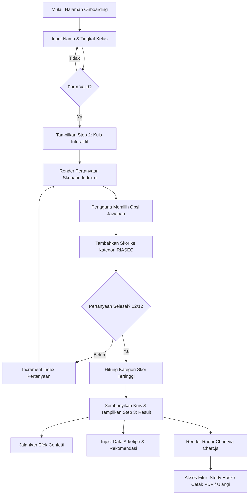

<div align="center">

  <br />
  <h1 align="center">🚀 FuturePath SMP</h1>
  <p align="center">
    <strong>Platform Asesmen Minat Bakat & Dashboard Orientasi Karir Interaktif Berbasis Framework RIASEC untuk Siswa SMP</strong>
  </p>

  <p align="center">
    <a href="#-tentang-proyek">Tentang Proyek</a> •
    <a href="#-fitur-utama">Fitur Utama</a> •
    <a href="#-metodologi-riasec">Metodologi RIASEC</a> •
    <a href="#-struktur-direktori">Struktur Direktori</a> •
    <a href="#-panduan-instalasi--penggunaan">Instalasi & Penggunaan</a> •
    <a href="#-arsitektur-teknologi">Arsitektur Teknologi</a> •
    <a href="#-lisensi--kontributor">Tim & Kontributor</a>
  </p>

  <!-- Badges -->
  <p align="center">
    
    
    
    
    
    
  </p>

  <br />

---

</div>

## 📌 Daftar Isi

- [📖 Tentang Proyek](#-tentang-proyek)
- [🎯 Tujuan & Latar Belakang](#-tujuan--latar-belakang)
- [✨ Fitur Utama](#-fitur-utama)
- [🧬 Metodologi Asesmen RIASEC](#-metodologi-riasec)
- [🏗️ Arsitektur & Logika Aplikasi](#-arsitektur--logika-aplikasi)
- [📁 Struktur Direktori](#-struktur-direktori)
- [🚀 Panduan Instalasi & Penggunaan](#-panduan-instalasi--penggunaan)
- [🛠️ Stack Teknologi](#-stack-teknologi)
- [📊 Spesifikasi 6 Arketipe Karakter](#-spesifikasi-6-arketipe-karakter)
- [💡 Teknik Belajar (Study Hacks Generator)](#-teknik-belajar-study-hacks-generator)
- [👥 Tim Pengembang](#-tim-pengembang)
- [📄 Lisensi & Hak Cipta](#-lisensi--hak-cipta)

---

## 📖 Tentang Proyek

**FuturePath SMP** adalah platform web interaktif yang dirancang khusus untuk memandu siswa Sekolah Menengah Pertama (SMP/MTs) di Indonesia dalam mengenali potensi diri, tipe kepribadian, serta jalur pendidikan formal yang relevan sejak dini.

Dikembangkan sebagai bagian dari **Proyek Mata Kuliah Wajib Kurikulum (MKWK) Universitas Sumatera Utara (USU)**, web platform ini mendukung pencapaian **Sustainable Development Goals (SDG) 4: Quality Education (Pendidikan Berkualitas)** dengan memberikan akses informasi orientasi karir yang inklusif, presisi, dan mudah dipahami oleh remaja.

```
       +-----------------------------------------------------------------+
       |                       FUTUREPATH SMP                            |
       +-----------------------------------------------------------------+
       |                                                                 |
  [ Onboarding ] ------> [ Skenario Interaktif ] ------> [ Dashboard Hasil ]
   • Nama Lengkap          • 12 Skenario Realistis       • Radar Chart RIASEC
   • Tingkat Kelas         • Kalkulasi Bobot Skor        • Rekomendasi SMA/SMK
                                                         • Rekomendasi Kuliah
                                                         • Peta Jalan (Roadmap)
                                                         • Study Hacks Generator
                                                         • Ekspor PDF
```

---

## 🎯 Tujuan & Latar Belakang

Banyak lulusan SMP mengalami dilema dalam menentukan pilihan pendidikan tingkat lanjut:
* **Kebingungan Menentukan Jalur SMA vs SMK:** Kurangnya pemahaman mendalam mengenai perbedaan orientasi pembelajaran SMA (akademis) dan SMK (vokasional/terapan).
* **Pemilihan Jurusan yang Kurang Tepat:** Penentuan jurusan (IPA/IPS/Bahasa di SMA atau konsentrasi keahlian di SMK) sering kali hanya mendasarkan pada tren atau dorongan eksternal, bukan potensi diri.
* **Kurangnya Perencanaan Karir Jangka Panjang:** Kebanyakan siswa belum memiliki gambaran keterkaitan antara pilihan sekolah saat ini dengan jurusan perguruan tinggi dan karir di masa depan.

**FuturePath SMP hadir untuk menyelesaikan permasalahan tersebut** dengan pendekatan kuis psikometrik terstruktur namun disajikan melalui skenario yang relevan dengan kehidupan sehari-hari siswa SMP.

---

## ✨ Fitur Utama

| Fitur | Deskripsi |
| :--- | :--- |
| **⚡ Onboarding Personalisasi** | Pengisian data awal nama dan kelas (7, 8, atau 9 SMP) untuk menyesuaikan sapaan dan laporan akhir secara personal. |
| **🎯 Kuis Skenario Interaktif** | 12 pertanyaan berbasis situasi sehari-hari (praktikum, organisasi, pemecahan masalah teknis, seni, dll.) untuk mengukur 6 dimensi RIASEC. |
| **📈 Dynamic Progress Indicator** | Visualisasi bilah kemajuan (progress bar) dan persentase yang terupdate secara *real-time* saat siswa menjawab kuis. |
| **📊 Chart Radar RIASEC** | Grafik radar visual menggunakan **Chart.js** yang menyajikan perbandingan skor 6 kepribadian secara transparan. |
| **🏫 Rekomendasi Jalur SMA & SMK** | Saran spesifik pilihan penjurusan SMA (IPA, IPS, Bahasa) serta konsentrasi SMK (TKJ, RPL, DKV, Akuntansi, dll.). |
| **🎓 Orientasi Kuliah & Karir Masa Depan** | Pemetaan jurusan Perguruan Tinggi Negeri/Swasta dan opsi karir profesional yang selaras dengan arketipe dominan. |
| **🗺️ Roadmap Persiapan Masa Depan** | Timeline 3 fase (Fase SMP, Fase SMA/SMK, dan Fase Perguruan Tinggi) sebagai panduan aksi konkret. |
| **🎲 Study Hacks Generator** | Modul generator acak yang menyajikan teknik belajar populer seperti *Pomodoro*, *Feynman Technique*, *Active Recall*, dan *Spaced Repetition*. |
| **🖨️ Cetak / Ekspor PDF** | Fitur cetak laporan langsung terintegrasi dengan fungsi *print-friendly layout* peramban. |

---

## 🧬 Metodologi RIASEC

Sistem scoring pada FuturePath SMP mengadaptasi **Teori Pilihan Karir Holland (Holland Codes / RIASEC Framework)** yang mengklasifikasikan tipe kepribadian kerja menjadi 6 dimensi utama:

```
                  [R] REALISTIC
                   /         \
                  /           \
    [C] CONVENTIONAL          [I] INVESTIGATIVE
           |                        |
           |                        |
     [E] ENTERPRISING         [A] ARTISTIC
                  \           /
                   \         /
                    [S] SOCIAL
```

### Penjelasan 6 Dimensi RIASEC:

1. **Realistic (R) — Practical & Hands-on**
   * **Fokus:** Aktivitas fisik, pengerjaan alat/mesin, perangkat keras (hardware), outdoor, dan solusi praktis.
   * **Karakter:** Mandiri, teknis, konkret, dan tanggap terhadap masalah mekanis.
2. **Investigative (I) — Analytical & Scientific**
   * **Fokus:** Analisis data, riset ilmiah, logika matematika, algoritma, dan pemecahan masalah kompleks.
   * **Karakter:** Kritis, penuh rasa ingin tahu, sistematis, dan suka bereksperimen.
3. **Artistic (A) — Creative & Expressive**
   * **Fokus:** Ekspresi seni, desain visual, musik, penulisan kreatif, UI/UX, dan gagasan out-of-the-box.
   * **Karakter:** Imajinatif, intuitif, original, dan tidak menyukai batasan kaku.
4. **Social (S) — Helping & Teaching**
   * **Fokus:** Hubungan antarmanusia, konseling, mengajar, pelayanan sosial, dan kerja sama tim.
   * **Karakter:** Empatis, komunikatif, ramah, dan tanggap terhadap kebutuhan orang lain.
5. **Enterprising (E) — Leadership & Business**
   * **Fokus:** Kepemimpinan, kewirausahaan, negosiasi, strategi bisnis, dan komunikasi persuasif.
   * **Karakter:** Ambisius, berani mengambil risiko, percaya diri, dan berjiwa pemandu.
6. **Conventional (C) — Structured & Detail-Oriented**
   * **Fokus:** Pengelolaan data, administrasi, ketaatan pada prosedur, kerapihan, dan akuntansi.
   * **Karakter:** Teliti, teratur, disiplin, dan menghargai keakuratan informasi.

---

## 🏗️ Arsitektur & Logika Aplikasi

Aplikasi dibangun menggunakan pola arsitektur **Single Page Application (SPA)** murni tanpa ketergantungan pada *framework* berat (Zero Heavy-Framework Dependency).

### Diagram Alur Aplikasi (Mermaid)



---

## 📁 Struktur Direktori

Berikut adalah susunan berkas dalam proyek **FuturePath SMP**:

```
FuturePath-SMP/
│
├── index.html          # Struktur HTML5 utama, markup komponen SPA, dan tautan CDN
├── style.css           # Styling kustom (Google Fonts, Gradient BG, Glassmorphism, override)
├── script.js           # Logika state, bank pertanyaan RIASEC, chart renderer, event handling
└── README.md           # Dokumentasi resmi proyek
```

---

## 🚀 Panduan Instalasi & Penggunaan

Proyek ini menggunakan *web stack* standar yang dapat dijalankan secara langsung tanpa memerlukan proses kompilasi (*build step*) atau instalasi `Node.js`/`npm`.

### 1. Kloning / Unduh Repositori
```bash
git clone https://github.com/username/futurepath-smp.git
cd futurepath-smp
```

### 2. Jalankan Aplikasi
Cukup buka berkas `index.html` menggunakan peramban web modern (Google Chrome, Mozilla Firefox, Microsoft Edge, Safari):

* **Cara 1:** Double-click file `index.html`.
* **Cara 2 (Diutamakan):** Gunakan ekstensi **Live Server** di VS Code untuk pengalaman pengujian terbaik.

```bash
# Apabila menggunakan npx serve (opsional)
npx serve .
```

---

## 🛠️ Stack Teknologi

Platform ini dirancang efisien dan ringan dengan menggunakan teknologi web modern:

* **HTML5:** Struktur semantik standar web accessibility.
* **CSS3 & Tailwind CSS:** Framework CSS utility-first untuk desain responsif dan konsisten.
* **Vanilla JavaScript (ES6+):** Logika asesmen, manipulasi DOM, state management tanpa overhead framework.
* **Google Fonts (Plus Jakarta Sans):** Tipografi modern yang jernih dan readable.
* **Chart.js (v4.x):** Visualisasi data interaktif untuk grafik radar RIASEC.
* **Canvas Confetti:** Efek micro-interaction saat penyerahan hasil asesmen.

---

## 📊 Spesifikasi 6 Arketipe Karakter

Berdasarkan kategori nilai RIASEC tertinggi, sistem secara otomatis memasangkan pengguna dengan salah satu dari 6 arketipe berikut:

```
+-----------------------------------------------------------------------------------------+
| ICON | TIPE ARKETIPE                         | KATEGORI | JURUSAN SMA/SMK         |
+-----------------------------------------------------------------------------------------+
| 🛠️   | Si Arsitek Sistem & Praktisi Teknis   | R        | SMA IPA / SMK TKJ & RPL |
| 🔬   | Si Analis Logika & Peneliti Sains     | I        | SMA IPA / SMK Kimia-RPL |
| 🎨   | Si Kreatif Inovatif & UI/UX Visioner  | A        | SMA Bebas / SMK DKV-Anim|
| 🤝   | Si Penggerak Empati & Konsultan       | S        | SMA IPS-IPA / SMK Sehat |
| 💼   | Si Pemimpin Visioner & Entrepreneur   | E        | SMA IPS / SMK Bisnis    |
| 📊   | Si Master Data & Manajer Terstruktur  | C        | SMA IPS / SMK Akuntansi |
+-----------------------------------------------------------------------------------------+
```

---

## 💡 Teknik Belajar (Study Hacks Generator)

Fitur **Booster Motivasi** menyediakan 5 teknik belajar teruji berbasis riset psikologi pendidikan:

1. ⏱️ **Teknik Pomodoro:** Belajar fokus 25 menit, diselingi istirahat 5 menit. Efektif menjaga kesegaran stamina mental.
2. 🗣️ **Teknik Feynman:** Menjelaskan kembali konsep rumit dengan bahasa yang sangat sederhana seolah mengajarkan anak kecil.
3. 🧠 **Active Recall:** Menguji daya ingat secara aktif tanpa melihat catatan untuk memperkuat jejak memori (*neural paths*).
4. 📅 **Spaced Repetition:** Mengulas kembali materi secara berkala (Hari ke-1, 3, 7, dan 30) untuk retensi jangka panjang.
5. ⚡ **Aturan 5 Menit:** Menembus prokrastinasi dengan berkomitmen belajar selama 5 menit pertama terlebih dahulu.

---

## 👥 Tim Pengembang

Proyek ini dikembangkan oleh Mahasiswa **Fakultas Ilmu Komputer dan Teknologi Informasi (FASS) / Program Studi Ilmu Komputer, Universitas Sumatera Utara (USU)** dalam rangka pelaksanaan **Proyek Mata Kuliah Wajib Kurikulum (MKWK) 2026**.

* **Fokus Proyek:** Sub-tema Pendidikan Berkualitas (SDG 4 - Quality Education).
* **Institusi:** Universitas Sumatera Utara (USU), Medan, Indonesia.

---

## 📄 Lisensi & Hak Cipta

Dipublikasikan di bawah **MIT License**.

```text
Copyright (c) 2026 Tim Proyek MKWK USU — Kelompok Pendidikan Berkualitas

Permission is hereby granted, free of charge, to any person obtaining a copy
of this software and associated documentation files (the "Software"), to deal
in the Software without restriction, including without limitation the rights
to use, copy, modify, merge, publish, distribute, sublicense, and/or sell
copies of the Software, and to permit persons to whom it is furnished to do so.
```

<div align="center">
  <br />
  <p><i>FuturePath SMP — Kenali Potensi, Gapai Masa Depan! 🚀</i></p>
</div>
